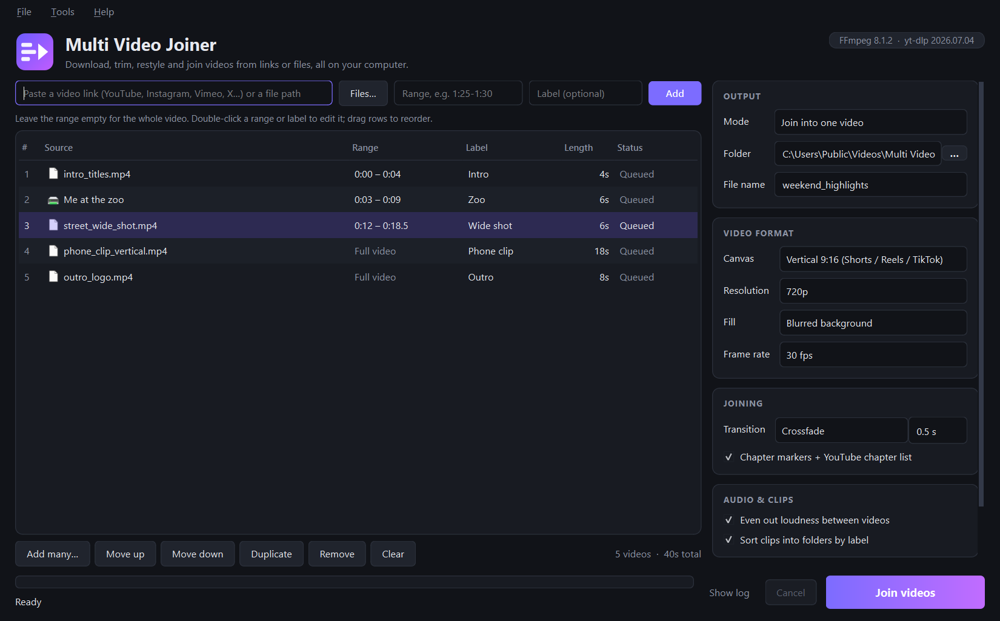
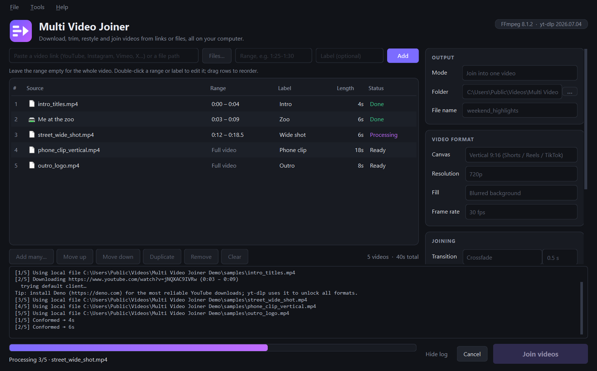
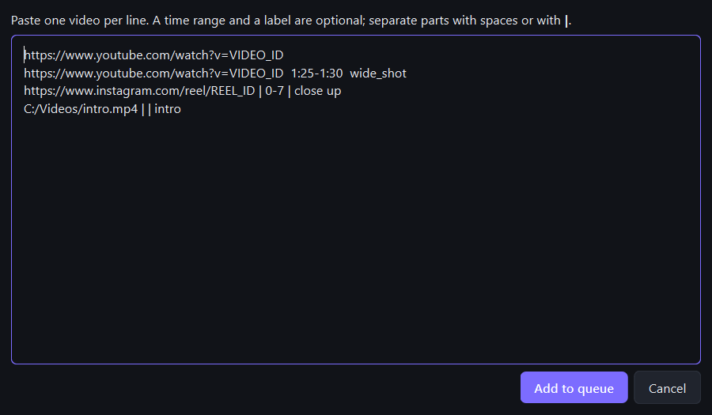
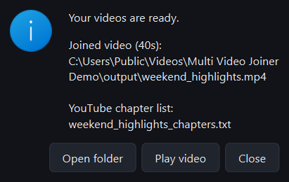

<p align="center">
  
</p>

<h1 align="center">Multi Video Joiner</h1>

<p align="center">
  <b>Download, trim, restyle and join videos from links or local files: one desktop app, everything runs on your computer.</b>
</p>

<p align="center">
  <a href="https://github.com/KOUSHIKSAVANTH/Multi_Video_Joiner/releases/latest">Download for Windows</a> ·
  <a href="#how-to-use-it">How to use</a> ·
  <a href="LICENSE">MIT License</a>
</p>

Paste links from YouTube, Instagram, Vimeo, X and [1,800+ other sites](https://github.com/yt-dlp/yt-dlp/blob/master/supportedsites.md), or drop in your own video files. You can take only the seconds you need from each one. Then either stitch everything into a single video with transitions and chapters, or export each piece as its own clip, for example to build a labelled dataset.



---

## Contents

- [What makes it different](#what-makes-it-different)
- [Download and install](#download-and-install)
- [How to use it](#how-to-use-it)
- [What you get](#what-you-get)
- [Settings reference](#settings-reference)
- [Troubleshooting](#troubleshooting)
- [Building it yourself](#building-it-yourself)
- [Project structure](#project-structure)

---

## What makes it different

| Feature | What it does |
| --- | --- |
| **Links and files in one queue** | Mix web links and local videos freely, then drag rows to set the order. |
| **Partial downloads** | Give a range like `1:25-1:30` and only those seconds are downloaded, not the whole video. |
| **Three output modes** | *Join into one video*, *Export separate clips*, or *both at once*. |
| **Any shape of video** | 16:9, **9:16 for Shorts / Reels / TikTok**, 1:1 or 4:5. Clips that don't fit get a **blurred background** (or classic black bars). |
| **Transitions** | Crossfade, fade through black or white, dissolve, wipe, slide, circle, pixelize, radial, with an adjustable length. |
| **Even loudness** | EBU R128 normalisation, so a quiet phone clip and a loud music video end up at the same volume. |
| **Chapters** | Each clip becomes a chapter inside the MP4, and a ready-to-paste **YouTube chapter list** is written next to it. |
| **Dataset export** | Clips are named by label and time range, sorted into one folder per label, and listed in a `manifest.csv`. |
| **Bulk add** | Paste dozens of lines like `URL 1:25-1:30 wide_shot`, or press **Ctrl+V** on the queue. |
| **Projects** | Save a queue and its settings as a `.mvj` file and reopen it later. Your last session is also restored on start-up. |
| **Hard-to-reach videos** | It tries several YouTube clients automatically and can use your browser's cookies for videos you're signed in to watch. |
| **Live progress, cancel any time** | Status on every row, a real progress bar driven by FFmpeg, and a detailed log. |
| **No setup** | The Windows build includes FFmpeg, so there's nothing else to install. |

---

## Download and install

### Option 1: Windows installer (recommended)

1. Go to the [**latest release**](https://github.com/KOUSHIKSAVANTH/Multi_Video_Joiner/releases/latest).
2. Download **`MultiVideoJoiner-Setup.exe`** and run it.
3. Open **Multi Video Joiner** from the **Start menu**.

The installer doesn't need admin rights. It adds a Start menu entry, an optional desktop icon and an uninstaller (**Settings → Apps**), and makes `.mvj` project files open in the app. FFmpeg is built in, so there's nothing else to install.

### Option 2: Portable app (no installation)

Download **`MultiVideoJoiner.exe`** from the same release and double-click it. It runs from anywhere, including a USB stick.
If you want it in the Start menu, use **Tools → Add to Start menu & desktop** inside the app.

> Windows SmartScreen may say *"Windows protected your PC"* because the app isn't code-signed.
> Click **More info → Run anyway**.

### Option 3: Install with pip (Windows, macOS, Linux)

Requires Python 3.10 or newer.

```bash
pip install git+https://github.com/KOUSHIKSAVANTH/Multi_Video_Joiner.git
multi-video-joiner
```

### Option 4: Run from source

```bash
git clone https://github.com/KOUSHIKSAVANTH/Multi_Video_Joiner.git
cd Multi_Video_Joiner
pip install -r requirements.txt
python main.py
```

FFmpeg is found automatically: it uses the one on your `PATH` if you have one, and otherwise the copy installed with `imageio-ffmpeg`.
With options 3 and 4, use **Tools → Add to Start menu & desktop** to get a shortcut (on Linux it adds an app-launcher entry).

---

## How to use it

1. **Add videos.** Paste a link and press **Enter**, or click **Files…**. You can also drag files, folders or browser links onto the queue, or press **Ctrl+B** to paste many lines at once.
2. **Trim (optional).** Type a range such as `0-7`, `1:25-1:30` or `0:05 to 0:12`. Leave it empty to use the whole video. For links, only that part is downloaded.
3. **Label (optional).** A label becomes the chapter title, the clip's file name and its dataset folder. The label field keeps its value after you add a row, so tagging several clips with the same label is quick.
4. **Arrange.** Drag rows, or use *Move up* and *Move down*. Double-click a range or label to edit it; *Duplicate* lets you cut several ranges from one video.
5. **Pick a mode and format** in the panel on the right.
6. Click **Join videos**, **Export clips** or **Export + join**, or press **Ctrl+Enter**.



### Adding many videos at once

Write one video per line. The time range and the label are optional; separate the parts with spaces or with `|`:

```text
https://www.youtube.com/watch?v=VIDEO_ID
https://www.youtube.com/watch?v=VIDEO_ID  1:25-1:30  wide_shot
https://www.instagram.com/reel/REEL_ID | 0-7 | close up
C:/Videos/intro.mp4 | | intro
```



### Keyboard shortcuts

| Keys | Action |
| --- | --- |
| `Ctrl+Enter` | Start |
| `Ctrl+V` (on the queue) | Paste links straight into the queue |
| `Ctrl+B` | Add many… |
| `Ctrl+O` | Add video files |
| `Delete` | Remove selected rows |
| `Ctrl+S` / `Ctrl+Shift+O` | Save / open a project |
| `Ctrl+L` | Show or hide the log |
| `F1` | Help |

---

## What you get



**Join mode**

```text
<output folder>/
├── joined_video.mp4             # chapters embedded
└── joined_video_chapters.txt    # paste into a YouTube description
```

Existing files are never overwritten; new ones get `_002`, `_003` and so on.

**Clips mode**, handy for building datasets:

```text
<output folder>/
├── wide_shot/
│   ├── wide_shot_01m25s_01m30s.mp4
│   └── wide_shot_03m02s_03m09s.mp4
├── close_up/
│   └── close_up_00m00s_00m07s.mp4
└── manifest.csv                 # file, label, source, start, end, duration, created
```

New rows are appended to `manifest.csv`, so you can grow the same dataset over several sessions.
**Both** mode puts the clips into a `clips/` sub-folder next to the joined video.

---

## Settings reference

| Setting | Options | Notes |
| --- | --- | --- |
| Mode | Join · Export clips · Both | |
| Canvas | 16:9 · 9:16 · 1:1 · 4:5 · Keep source size | *Keep source size* uses the first clip's size when joining. |
| Resolution | 480p – 2160p | The short side of the frame; also the maximum download quality. |
| Fill | Blurred background · Black bars | Used when a clip's shape differs from the canvas. |
| Frame rate | 24 · 25 · 30 · 50 · 60 | |
| Transition | None + 9 styles, 0.2–3 s | It is shortened automatically if a clip is very short. |
| Chapters | on / off | Embedded chapters plus `*_chapters.txt`. |
| Even out loudness | on / off | EBU R128, −16 LUFS. |
| Sort clips into folders by label | on / off | Clips mode only. |
| Cookies | Automatic · none · Chrome / Edge / Firefox / Brave / Opera / Vivaldi · cookies.txt | Only for videos your account can already watch. |

All settings and the current queue are remembered between sessions.

---

## Troubleshooting

| Problem | Fix |
| --- | --- |
| *"Sign in to confirm you're not a bot"* or an age-restricted video | Under **Cookies**, choose the browser where you're signed in. Close that browser first if it's Chrome or Edge, or export a `cookies.txt` instead. |
| A site suddenly stopped working | **Tools → Update yt-dlp** (source installs). For the Windows app, download the newest release. |
| The log says *"install Deno"* | Install [Deno](https://deno.com). yt-dlp uses it to unlock every YouTube format. Downloads usually still work without it. |
| I can't find the app in the Start menu | The portable `.exe` and pip installs don't add one on their own. Use **Tools → Add to Start menu & desktop**, or install with `MultiVideoJoiner-Setup.exe`. |
| *"FFmpeg not found"* | Run `pip install imageio-ffmpeg`, or install FFmpeg and add it to `PATH`. |
| The range is past the end of the video | The row's status turns orange. Fix the range by double-clicking it. |

---

## Building it yourself

```bash
pip install -r requirements.txt pyinstaller pillow
python scripts/build.py               # → dist/MultiVideoJoiner.exe (portable)
python scripts/build.py --installer   # → also dist/MultiVideoJoiner-Setup.exe (needs Inno Setup 6)
python scripts/make_logo.py           # re-export logo.png / icon.ico after changing the logo
```

**Automatic releases:** pushing a version tag makes GitHub Actions run the tests, build the installer and the portable `.exe`, and attach both to a new release.

```bash
git tag v3.0.0
git push origin v3.0.0
```

**Tests and screenshots:**

```bash
pip install pytest
python -m pytest                     # unit tests + real FFmpeg pipeline tests
python scripts/make_screenshots.py   # regenerates docs/screenshots/ from the real app
```

---

## Project structure

```text
├── main.py                  # launcher: python main.py
├── mvjoiner/
│   ├── app.py               # application start-up
│   ├── ui.py                # main window, queue, settings panel
│   ├── engine.py            # pipeline: acquire → conform → export clips / join
│   ├── downloader.py        # yt-dlp: metadata, full and partial downloads, fallbacks
│   ├── ffmpeg_tools.py      # locate FFmpeg, probe media, run with progress and cancel
│   ├── timeparse.py         # time ranges, labels, bulk-line parsing
│   ├── project.py           # .mvj project files
│   ├── shortcuts.py         # Start menu / desktop shortcuts
│   ├── theme.py             # dark theme + logo (drawn in code)
│   └── assets/              # logo.png, icon.ico (exported from theme.py)
├── installer/
│   └── MultiVideoJoiner.iss # Windows installer (Inno Setup)
├── scripts/
│   ├── build.py             # PyInstaller + installer build
│   ├── make_logo.py         # export the logo files
│   └── make_screenshots.py  # README screenshots
├── tests/                   # automated tests (not needed to run the app)
├── docs/screenshots/
├── .github/workflows/release.yml
├── LICENSE
├── pyproject.toml
└── requirements.txt
```

**Built with** Python · PySide6 (Qt) · yt-dlp · FFmpeg

---

## Responsible use

This tool is for content you own or have permission to download and reuse. It does not bypass DRM, paywalls or private accounts. Cookies only let it see what your own signed-in account can already watch. Respect each site's terms of service and the creators' copyright.

---

## License

[MIT](LICENSE) © 2026 KOUSHIKSAVANTH. You're free to use, modify and share this app; please keep the copyright notice.
